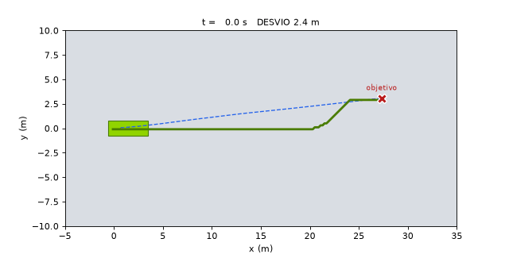

# VA 2026/2027 · Grupo 07 · GNSS + odometria

Localização do carro com GNSS/INS NovAtel SPAN-IGM-S1 e odometria do CAN bus (ângulo de direção do
Mitsubishi i-MiEV): aquisição em ROS 2, análise off-line e, na parte 2, o próximo waypoint da rota
global publicado como objetivo do planeador local (A*).

<!--    (Ex. 6: gerar com tools/figura_bag.py) -->

| | |
|---|---|
| **Sensor** | NovAtel SPAN-IGM-S1 (GNSS + IMU ADIS16488), USB-série 230400 baud; INSPVAS 50 Hz, BESTPOS 10 Hz, RAWIMUSX 200 Hz · CAN bus do carro via USB2CAN (8devices), 500 kbit/s, listen-only |
| **Posição no carro** | <frame_id da antena e do IMU, x y z (m) e orientação em relação ao base_link: a medir> |
| **Driver ROS 2** | `ros-jazzy-novatel-oem7-driver` (com overrides para firmware OEM6) · `ros-jazzy-ros2-socketcan` |
| **Saídas** | `/novatel/oem7/*`, `/can/raw`, `/can/steering_angle`, `/g07/objetivo` (parte 2), `/g07/caminho_local`, `/g07/estado` |
| **Equipa** | João Ferreira (113571), Carlos Laranjeira (113524) |

## Arquitetura

| Serviço (compose) | Nó | Subscreve | Publica |
|---|---|---|---|
| `driver` | `novatel_oem7_driver` | | `/novatel/oem7/inspva`, `/novatel/oem7/bestpos`, `/novatel/oem7/rawimusx`, ... |
| `can` | `socketcan_receiver` + `can_direcao.py` | `can0` | `/can/raw` (can_msgs/Frame), `/can/steering_angle` (ackermann_msgs/AckermannDriveStamped) |
| `percecao` | `scan_to_grid` (exemplo do modelo; o nó do G7 entra no Ex. 4) | `/scan`, `/tf_static` | `/g07/grelha_local` (nav_msgs/OccupancyGrid) |
| `planeador` | `local_astar` (comum, `src/va_planeamento`) | `/g07/grelha_local`, `/g07/objetivo` | `/g07/caminho_local` (nav_msgs/Path), `/g07/estado` (std_msgs/String), `/g07/zona_proibida` |

## Estrutura

| Ficheiro | Função |
|---|---|
| `Dockerfile` | Imagem: ROS 2 Jazzy + driver NovAtel + SocketCAN + MCAP + Foxglove + workspace `src/` |
| `compose.yaml` / `compose.windows.yaml` | Serviços (Linux / Windows). Profiles: `sensor`, `simulado`, `reproduzir`, `gravar`, `foxglove`, `rviz` |
| `.env` | Configuração: grupo, ROS_DOMAIN_ID, percurso, recetor, CAN, bag a reproduzir |
| `docker/` | Scripts que correm dentro do contentor (driver, CAN, gravação, verificação, deteção da porta) |
| `src/va_planeamento/` | **Comum** (do modelo, sem alterações): grelha local + A* |
| `src/va_g07/` | **Do grupo**: simulador e nó de perceção do modelo (por agora), parâmetros em `config/params.yaml` |
| `tools/` | `figura_bag.py` (figuras e GIF a partir de um bag) |
| `ler_bag.sh` / `ler_bag.py` | Análise off-line sem ROS: resumo, trajetória, atitude, CSV |
| `ler_can.sh` / `ler_can.py` | CAN off-line sem ROS: IDs gravados e ângulo de direção descodificado de `/can/raw` (CSV + PNG) |
| `data/` | Bags MCAP (na aquisição real, apontar `DATA_DIR` para o SSD externo) |

## Como correr

Requisitos: Docker (Ubuntu 24.04 com Docker Engine; Windows com Docker Desktop, sem sensores).

```bash
git clone https://github.com/j9126f/va_gnss_odometry.git && cd va_gnss_odometry
docker compose build                                  # uma vez (demora alguns minutos)
docker compose --profile simulado up                  # sem sensor: LiDAR simulado + perceção + planeador
BAG=<pasta_em_data> docker compose --profile reproduzir up   # com um bag gravado
```

Windows (PowerShell): `$env:COMPOSE_FILE = "compose.windows.yaml"` antes dos comandos acima.
Visualização: `--profile foxglove` e, no Lichtblick/Foxglove, `ws://localhost:8765`.

### Aquisição no carro

```bash
docker compose run --rm driver detectar_recetor.py    # só se a deteção automática falhar
docker compose up driver                              # só o driver (para verificar)
docker compose exec driver verificar.sh               # (outro terminal) confirma que há dados
docker compose --profile sensor --profile gravar up   # driver + CAN + gravação (Ctrl+C para parar)
./ler_bag.sh data/<pasta_do_bag>                      # análise
sudo chown -R $USER data                              # se precisares de mover/apagar bags
```

Parâmetros que dependem do carro (`.env`): `OEM7_DEVICE` / `OEM7_IP`, `OEM7_BAUD`, `CAN_IF`,
`CAN_BITRATE`, `CAN_DIRECAO_*`, `CAN_RELACAO_DIRECAO`.

## Tópicos do sensor

Medido com `ros2 topic hz`, `ros2 topic echo --field header` e `ros2 topic info -v` a reproduzir os bags
`g00_gnss-ins_20261113_140141_teste1` e `g00_can_20261118_161425_exterior1` (Ex. 3 da aula 10).

| Tópico | Tipo | frame_id | Frequência | QoS (reliability) |
|---|---|---|---|---|
| `/novatel/oem7/inspva` | `novatel_oem7_msgs/msg/INSPVA` | `gps` | 50 Hz | RELIABLE |
| `/novatel/oem7/fix` | `sensor_msgs/msg/NavSatFix` | `gps` | 50 Hz | RELIABLE |
| `/novatel/oem7/odom` | `nav_msgs/msg/Odometry` | `odom` | 50 Hz | RELIABLE |
| `/novatel/oem7/bestpos` | `novatel_oem7_msgs/msg/BESTPOS` | `gps` | 10 Hz | RELIABLE |
| `/novatel/oem7/bestvel` | `novatel_oem7_msgs/msg/BESTVEL` | `gps` | 10 Hz | RELIABLE |
| `/novatel/oem7/rawimusx` | `novatel_oem7_msgs/msg/RAWIMUSX` | `imu_link` | 200 Hz ¹ | RELIABLE |
| `/novatel/oem7/inspvax` | `novatel_oem7_msgs/msg/INSPVAX` | `gps` | 1 Hz | RELIABLE |
| `/can/raw` | `can_msgs/msg/Frame` | `can` | ~1600 Hz (todas as tramas) | RELIABLE |
| `/can/steering_angle` | `ackermann_msgs/msg/AckermannDriveStamped` | `base_link` | 100 Hz | BEST_EFFORT |

¹ 105 007 mensagens em 525 s; o `ros2 topic hz` mede só ~175 Hz porque não acompanha esta taxa.
Os bags **não têm `/tf` nem `/tf_static`**: falta publicar as transformações `base_link` → `gps` e
`base_link` → `imu_link` (posição da antena e do IMU no carro).

## Dados

| Bag | Data | Percurso | Duração | Tópicos |
|---|---|---|---|---|
| `g00_gnss-ins_20261113_135159_teste` | 2026-11-13 | interior (sem fix GNSS) | 30 s | `/novatel/oem7/*` |
| `g00_gnss-ins_20261113_140141_teste1` | 2026-11-13 | exterior, 1.ª volta | 8,7 min | `/novatel/oem7/*` |
| `g00_can_20261118_161425_exterior1` | 2026-11-18 | exterior | 41,5 s | `/can/raw`, `/can/steering_angle` |

Os bags gravados antes da aula 10 têm o prefixo `g00` (o grupo ainda não estava definido).

## CAN bus (ângulo de direção)

Adaptador USB2CAN (8devices) -> interface SocketCAN `can0`. O serviço `can` configura-a em **listen-only**
(não transmite nem confirma tramas: não interfere com o carro) e publica:

| Tópico | Tipo | Conteúdo |
|---|---|---|
| `/can/raw` | `can_msgs/Frame` | todas as tramas do barramento (sempre) |
| `/can/steering_angle` | `ackermann_msgs/AckermannDriveStamped` | `drive.steering_angle` = ângulo das rodas da frente (rad, + = esquerda), só com `CAN_DIRECAO_ID` definido |

A mensagem do ângulo é diferente em cada carro. Para a descobrir (carro ligado e parado):

```bash
docker compose run --rm can can_identificar.py --bitrate auto   # 1.ª vez: descobre o bitrate -> CAN_BITRATE
docker compose run --rm can can_identificar.py                  # centro -> batente esq. -> batente dir. -> 1 volta
```

Copiar as linhas `CAN_DIRECAO_*` sugeridas para o `.env`. Depois:
- **Sentido**: virar à esquerda tem de dar ângulo positivo; senão `CAN_DIRECAO_SENTIDO=-1`.
- **Escala**: medida na última fase (volante rodado exatamente uma volta, 360º, para a esquerda: o
  símbolo do volante fica outra vez direito). Não é preciso saber o ângulo do batente.
- **Volante vs rodas**: a escala medida dá graus de volante. `CAN_RELACAO_DIRECAO` = desmultiplicação da
  direção (ficha técnica, ≈ 14-17, ou ângulo do volante no batente / ângulo das rodas no batente);
  o `/can/steering_angle` sai já em ângulo das rodas.

Como `/can/raw` é sempre gravado, um bag feito antes de acertar o sinal não se perde: corrigir o `.env` e
correr `./ler_can.sh data/<pasta_do_bag>`. A velocidade das rodas (odómetro) vem também em `/can/raw`.

## Problemas comuns

- **Sem porta série**: `ls /dev/ttyUSB* /dev/ttyACM*` no portátil; confirmar cabo e alimentação.
- **Porta ocupada** ao detetar: parar o driver (`docker compose down`).
- **Sem dados em `inspva` / INS não alinhado**: o INS precisa de GNSS e de movimento para alinhar.
- **Ethernet**: preencher `OEM7_IP` no `.env` e confirmar com `ping`.
- **CAN sem tramas**: carro com a ignição ligada? bitrate certo (`can_identificar.py --bitrate auto`)?
  `docker compose logs can` e, no portátil, `ip -details -statistics link show can0` (erros de barramento = bitrate errado).
- **Mudar o bitrate com o serviço `can` a correr**: `docker compose down` primeiro (a interface só é reconfigurada se estiver em baixo).
- **Acesso ao USB falha**: em `compose.yaml`, no serviço `driver`, acrescentar `privileged: true`.
